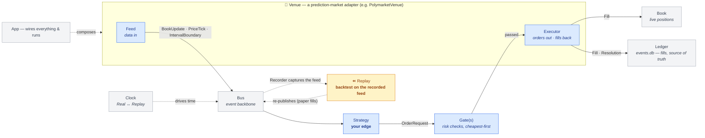

# Naming & Vocabulary

The words a user learns when building on the framework. Goal: **crisp, memorable,
benefit-oriented** names that are marketing-friendly *because* they're clear, not cute. The
brand lives in the product name + the headline feature (**Replay**) + a consistent
one-word vocabulary, never in jargon that taxes the person trying to ship a strategy.

> Product name: **`oraclebook`** — `pip install oraclebook`, `from oraclebook import …`.
> (PyPI + GitHub org confirmed free; `oraclebook.dev` / `.io` available.)

## The core vocabulary — the 7 nouns everyone learns

Each is one word, PascalCase as a class, lowercase as a concept. This is the whole mental model.

| Name | One-line (landing-page voice) | What you edit | Example |
|---|---|---|---|
| **Feed** | *Plug in any data source.* | subclass to stream a new data source onto the bus | `BinanceFeed`, `PolymarketFeed` |
| **Market** | *The thing you trade.* | rarely — the venue adapter builds these | `Market(venue=…, token_ids=…)` |
| **Strategy** | *Write your edge in one class.* | **the main thing you write** — consume events, emit orders | `CompleteSetMaker` |
| **Executor** | *Orders out, fills back.* | swap paper ↔ live, or add a venue's order API | `PaperExecutor`, `PolymarketExecutor` |
| **Gate** | *Stack pre-trade checks, cheapest first.* | add a risk check; gates compose + short-circuit | `StalenessGate`, `BalanceGate` |
| **Venue** | *Add a prediction market in one folder.* | bundle a venue's Feed + Executor + settlement + fees | `PolymarketVenue` |
| **Replay** | *Backtest on real recorded order books (paper fills, reproducible per feed).* | the headline feature; record live → replay → analyze | `oraclebook replay …` |

## The supporting cast (you'll see these, rarely subclass them)

| Name | Was | Role |
|---|---|---|
| **App** | `TradingNode` | the composition root you instantiate and run (`App.run()`) |
| **Bus** | `MessageBus` | the pub/sub event backbone (internal) |
| **Book** | `PositionTracker` | your live positions + account — the one place positions mutate |
| **Ledger** | `EventLog` | append-only event store, the source of truth (`events.db`) |
| **Clock** | `TimeProvider` | time source — `RealClock` live, `ReplayClock` in **Replay** |

## Domain facts (immutable nouns that flow through the system)

`Order` → `Fill` → `Position` → `Resolution`. Events are **past-tense facts**:
`OrderFilled`, `PositionResolved`, `IntervalBoundary`, `BookUpdate`, `PriceTick`.

## Naming conventions — the rules for adding your own

So a contributor never has to guess what to call a new thing:

- **Feeds:** `<Source>Feed` → `BinanceFeed`, `PolymarketFeed`, `KalshiFeed`
- **Executors:** `<Venue>Executor` (+ always a `PaperExecutor` for simulation) → `PolymarketExecutor`
- **Gates:** `<Check>Gate` → `StalenessGate`, `EdgeFloorGate`, `InventorySkewGate`
- **Venues (adapters):** `<Venue>Venue` living in `adapters/<venue>/` → `PolymarketVenue`
- **Strategies:** descriptive `PascalCase`, no suffix → `CompleteSetMaker`, `MeanReverter`
- **Events:** past-tense fact nouns; topic constants are `EVT_<NAME>` (e.g. `EVT_ORDER_FILLED`)
- **Protocols (the seams):** the bare role name, no `Like`/`Base` noise → `Feed`, `Executor`, `Gate`, `Venue`

## "What will I actually edit?" — the 5 extension points

The whole framework, from a builder's view, is five verbs:

1. **Write a `Strategy`** — your logic. (99% of users start and stop here.)
2. **Add a `Gate`** — a risk rule.
3. **Add a `Feed`** — a new data source.
4. **Add a `Venue`** — a whole new prediction market (Feed + Executor + settlement + fees).
5. **Run `Replay`** — backtest it on recorded order flow before risking a cent.

Everything else (App, Bus, Book, Ledger, Clock) is wiring the framework handles for you.

## The picture — how the names connect

🟦 = **you edit it**  ·  ⬜ = framework wiring  ·  🟨 = headline feature



ASCII fallback:

```
          🔌 VENUE adapter (PolymarketVenue, KalshiVenue, …)
        ┌──────────────────────────────────────────────────┐
        │  🟦 Feed ──events──▶          ◀──fills── 🟦 Executor│
        └────┼──────────────────────────────────────▲───────┘
             │ BookUpdate · PriceTick · Boundary     │ passed
             ▼                                       │
         ⬜ Bus ───────▶ 🟦 Strategy ──OrderRequest──▶ 🟦 Gate(s)
                          (your edge)                  (risk checks)
                                                       │
   ⬜ Clock (Real↔Replay) ─drives time─▶ Bus           ▼ Fill
                                              ⬜ Book (positions)
   ⬜ Ledger ◀── Fill · Resolution ──┘        (events.db = fills, the source of truth)
   🟨 Replay: a Recorder captures the Feed → Replay re-publishes it to the Bus on a
              virtual clock (paper fills; reproducible for a single feed)

   ⬜ App = wires Venue + Strategy + Gates + Executor and runs the loop.
```

Read it as the **five verbs**: a **Feed** pushes events onto the **Bus**; your **Strategy** turns them
into orders; **Gates** vet them; the **Executor** places them; **Fills** update the **Book** and the
**Ledger**; and a **Recorder** captures the **Feed** to a recording that **Replay** re-publishes to
the **Bus** on a virtual clock (reproducible for a single feed; fills simulated by the paper
executor), so you backtest on the real recorded order books before risking a cent. A **Venue**
bundles the Feed + Executor + settlement + fees for one market; the **App** wires it together.
